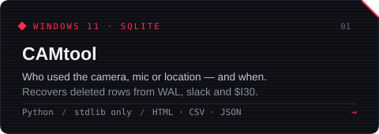
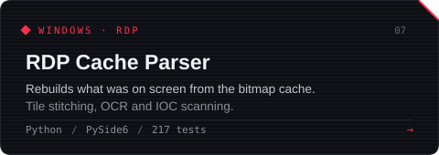
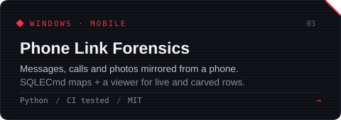
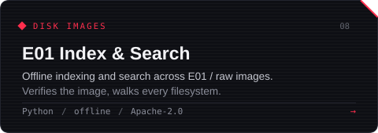
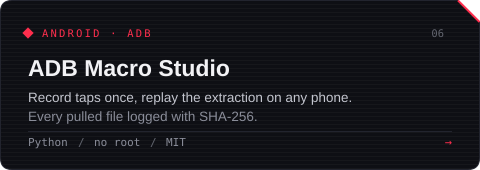
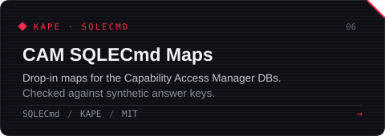
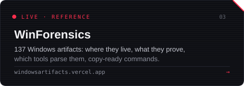
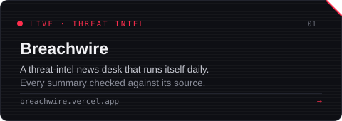

  

  I write forensic parsers for artifacts that don't have one yet, 
  and go looking where deleted rows survive: <code>-wal</code> files, freed pages, slack.

  
  
  

 

  

 

  
  
  
  
  
  
  
  

 

  <a href="https://www.linkedin.com/in/avinash-kotla">linkedin</a> &nbsp;·&nbsp;
  <a href="https://whitedevil1026.github.io/">blog</a> &nbsp;·&nbsp;
  <a href="mailto:avinaskkotla3699@gmail.com">email</a> &nbsp;·&nbsp;
  <a href="https://github.com/whitedevil1026?tab=repositories">all repos</a>

