  

<code>~/whoami</code>

  <b>Digital Forensic Analyst at Tata Consultancy Services.</b> 
  I run end-to-end investigations across Windows, Linux and mobile, from evidence acquisition 
  and chain of custody through analysis to the final report.

  The core of the work is correlation: bringing logs, artifacts and device evidence together 
  into a single timeline that can be defended. When a tool doesn't exist for the artifact in front of me, 
  I build one. That's where every project below came from.

  
  
  

 

  

  

 

  
  
  
  
  
  
  
  

 

  

  
  
  
  

